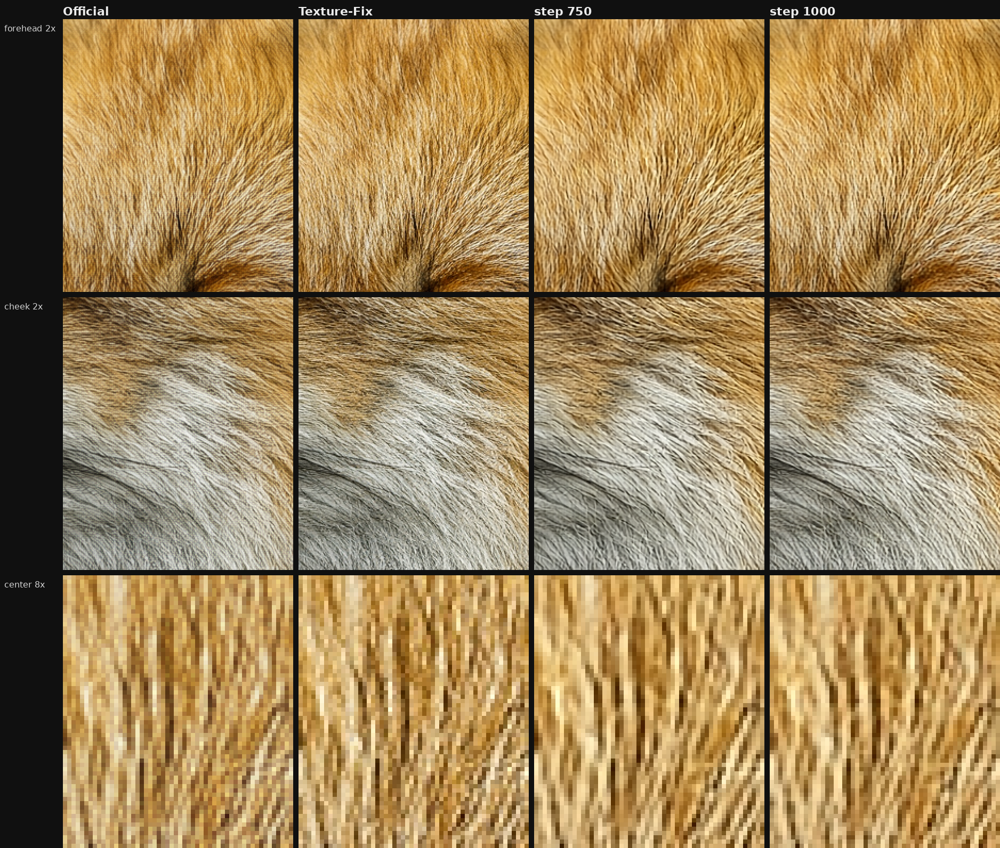
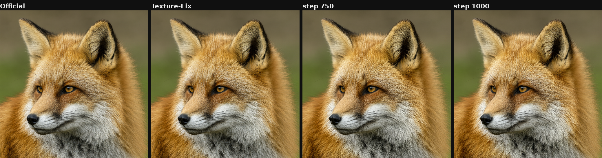
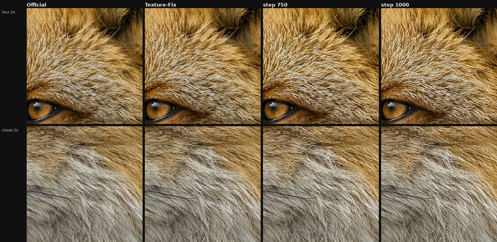
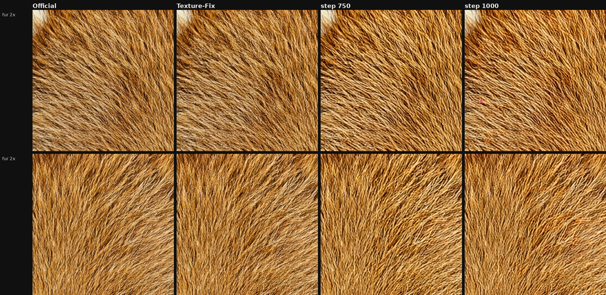
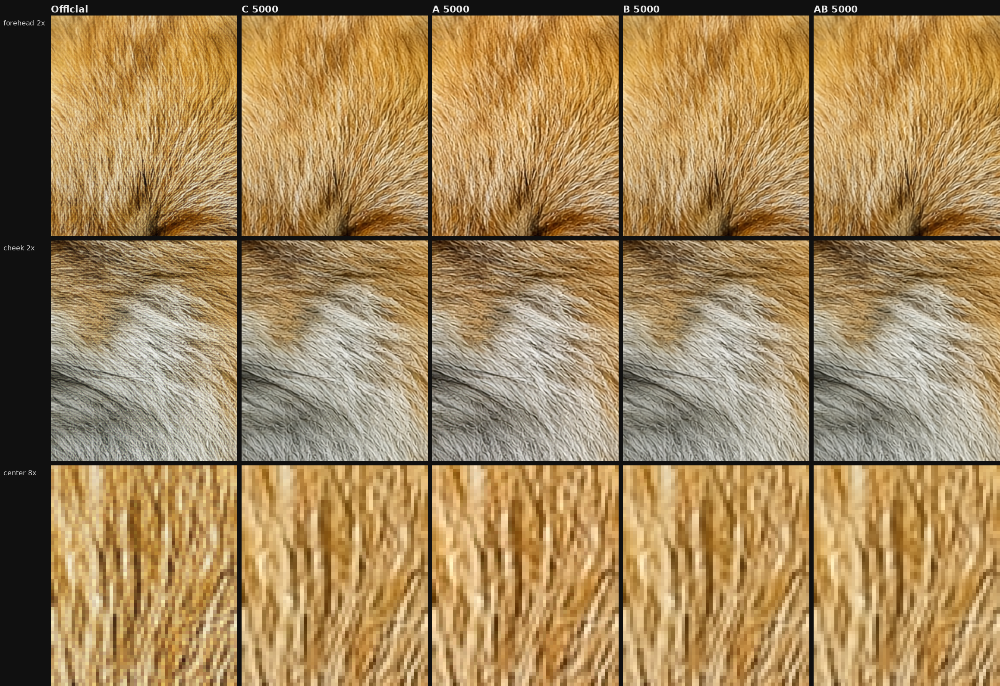
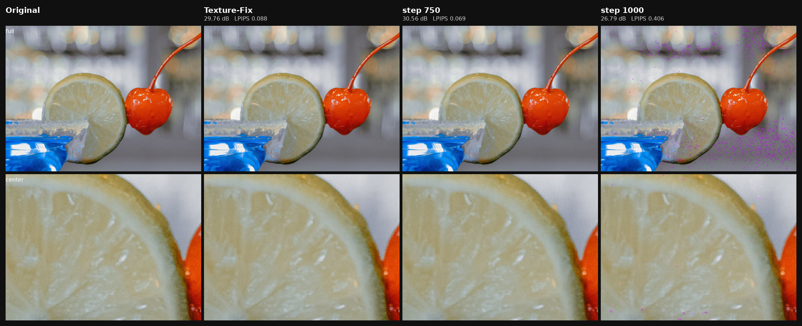

# 狐狸额头上的 8 像素网格

这是一篇社区实验记录，写 Qwen-Image 2.1 的 VAE 解码器。基线是 [madebyollin/texture-fix-vae-for-qwen-image-2.1](https://huggingface.co/madebyollin/texture-fix-vae-for-qwen-image-2.1)，它是 [Qwen/Qwen-Image-2.1](https://huggingface.co/Qwen/Qwen-Image-2.1) 的非官方微调。我们在那份权重上又训了 750 步。生产用的解码器没有换。

生成图的毛发上有三层周期纹。最细的那层是相邻像素一明一暗，Texture-Fix 已经压掉，毛还更利。剩下两层按输出像素算：横竖每 8 像素一格，斜向每 4 像素一格。

8 像素这一格生在解码器 `up_blocks.2` 的第一次 SiLU，4 像素斜纹生在 `up_blocks.3` 的第一次 SiLU。从官方权重把解码器训 5000 步，生成图上的 8 像素网格还在。照片损失一减弱，内容就漂。

所以这一次从 Texture-Fix 出发，只训这两级。照片损失用强的那一档，锐度不许掉到 Texture-Fix 以下。第 750 步网格淡了，毛还在。SiLU 盖下去的力度没变，它后面的卷积把图案挡在 RGB 之外。第 1000 步有一张照片崩了，不留。

## 先看图

同一张 turbo 狐狸、同一个潜变量。从左到右：官方解码、Texture-Fix、第 750 步、第 1000 步。上排额头，中排脸颊，下排额头中心放大 8 倍。



官方那一列能看见横竖织纹，毛也偏软。Texture-Fix 把最细的棋盘收掉了，毛更清楚，格子还在。第 750 步格子淡下去，毛的走向还在。第 1000 步格子又显一点。整张在下面。



另外两张验收图用同一列顺序。非 turbo 的狐狸，格子本来就轻一些，750 步仍比 Texture-Fix 淡，毛没有抹平。



2048 的熊猫窗。750 步格子更淡，毛也更冲。这张上多出来的锐度是这轮最明显的副作用，后面会写进表。



## 三种纹分别怎么量

三张图用的是同一套数，都是纹理小窗的中位数，窗取每张图前三个纹理框。

8 像素网格看频谱上四个点有多突出：横着周期 8、竖着周期 8。周围频谱已经被减掉。这个数在 1 附近，表示该频率并不特别亮。狐狸上官方大约 2.2，就是额头上看得见的那层格子。

2 像素棋盘看 2×2 小块里明暗错开多少，单位是灰度级。官方狐狸大约 2.7。Texture-Fix 收到 0.4 以下，肉眼上最细的那层棋盘就没了。

锐度是亮度梯度的均方根，再乘 255。越大越利。消网格的时候这个数若往下掉，毛会先糊。Texture-Fix 的价值就在这里：它把 2 像素收掉的同时，锐度是升的。

4 像素斜纹是对角的四个频谱点，读法和 8 像素一样。这轮没有把它一起修好，表里照实写。

用纹理库里的同一张 turbo 狐狸把 Texture-Fix 已经做成的事说清楚：官方是 8 像素 2.20、2 像素 2.72、锐度 28.7；Texture-Fix 是 2.19、0.38、32.2。2 像素掉了一个数量级，锐度升高，8 像素原地。后面和 750 步比较时，改用这次训练第 0 步的数。第 0 步就是这套代码加载 Texture-Fix 权重的结果，和纹理库对得上，8 像素差大约 0.01。

## 纹从哪一层生出来

1024 的输出里，`up_blocks.2` 的一个特征像素对应画面上的 8 像素，`up_blocks.3` 对应 4 像素。定位做在 10 月 12 日那张固定的狐狸额头潜变量上，官方权重和 Texture-Fix 都量过。过程、对照表和“不要换掉 SiLU”的边界写在 [算子级定位](docs/localization-20261012.md)。这里只留和训练有关的三件事。重测占比用 `experiments/localize/trace_silu.py`。

第一，8 像素分量主要生在 `up_blocks.2` 第一个残差块的第一次 SiLU。进激活之前，它只占特征标准差的 3.5%。出来之后占 25%。再过一层卷积，占 64%。4 像素斜纹同样的事情发生在 `up_blocks.3` 的第一次 SiLU，从不到 1% 升到 16%。

第二，在 SiLU 之前把这个频带挖掉，额头上的 8 像素峰还是 2.91，基线是 2.95。挖在 SiLU 之后，峰落到 0.49。所以出生点在这次激活。

第三，把 SiLU 换成线性，或者把每一级的周期都硬滤掉，图会坏。三级一起滤，额头 RGB 挪了大约 20.7 个灰度级，毛的组织也变了。这些周期分量还承担着正常重建。训练要管的是它会不会走到像素上。SiLU 留在原地。

Texture-Fix 的权重上，这组比例和官方几乎一样。它修好了 2 像素，没有拆掉 8 像素的出生点。

## 从官方权重训了四组

Texture-Fix 说明白了高分辨率那几级值得训。我们仍想知道：从官方权重出发，换损失和判别器，能不能自己把生成图上的 8 像素网格训掉。四组一起跑了 5000 步，编码器冻住，学习率 5e-5，数据相同。

| 组 | 照片损失 | 判别器 | PSNR | LPIPS | 照片上的 2 像素 |
| --- | --- | --- | ---: | ---: | ---: |
| 起点 | 官方权重，还没训 |  | 32.29 | 0.069 | 1.10 |
| C | 像素 1.0，LPIPS 0.05 | 无条件 | 32.67 | 0.051 | 0.30 |
| A | 像素 0.1，LPIPS 0.005 | 无条件 | 30.95 | 0.060 | 0.31 |
| B | 像素 1.0，LPIPS 0.05 | 条件 | 32.80 | 0.050 | 0.30 |
| AB | 像素 0.1，LPIPS 0.005 | 条件 | 32.82 | 0.049 | 0.30 |

除起点外都是第 5000 步。八张都是训练没见过的照片裁剪。PSNR 越高，像素越接近原图。LPIPS 越低，看上去越接近原图。

照片上的 2 像素在第 250 步就掉到 0.31 到 0.34，四组之后几乎不动。这个数只描述照片重建。生成图上的 8 像素格子是另一件事：中途略降，到 5000 步又回到接近起点。第 250 步的照片相位下降，代表照片上的细棋盘淡了。

A 把像素和 LPIPS 的权重放弱。5000 步平均 PSNR 掉到 30.95，内容漂了。这一组淘汰。AB 的终点 PSNR 最高，LPIPS 不如 B。B 在第 3500 步 LPIPS 0.0405，是强锚点里照片最好的检查点之一；它的毛更软，8 像素格子还在。B 可以当一个更贴照片的解码器，不能换掉 Texture-Fix。

第 5000 步的狐狸额头和脸颊。列是官方、C、A、B、AB。四组训练结果里织纹都还在。



这四组把照片锚点定下来了：用 B 的强度，像素 1.0、LPIPS 0.05，再加已经在用的低频项 0.25。像素和 LPIPS 再放弱，图会漂。它们没有选出 `up_blocks.2` 和 `.3`。选出这两级的是上一节的 SiLU 定位，再加上 Texture-Fix 没训过 `.2`、8 像素网格还在。

## Texture-Fix 动过哪几级

作者的说明写得很具体。初版大约 5000 步，学习率 3e-5，只解冻分辨率最高的两级解码器和输出头，可训参数 750 万，损失是 MSE、LPIPS 和 GAN，配方来自他的 TAESD。后来的版本为了 fp16 不溢出，又调过卷积的 scale、bias 和 RMSNorm 的 gain，并把权重按 2 的整数次幂缩小。编码器算的还是原来的函数，只是缩放。原文：<https://huggingface.co/madebyollin/texture-fix-vae-for-qwen-image-2.1>。

按他这份权重里的参数量，对得上的是 `up_blocks.3`（614 万）、`up_blocks.4`（135 万）和输出头（1 万）。`up_blocks.2` 有 2522 万，不在这 750 万里。他说的“最高分辨率两级”，比 8 像素那一级更靠输出。编号差一级，最容易混在这里。

作者还写了一句：他怀疑官方 VAE 训练时对抗损失没有真正生效。那是他的推测。我们没有检查原始训练，这篇记录不把它当成自己的结论。我们采用的是他公布的权重、他写明的训练范围，以及我们在同一潜变量上量到的差：2 像素下去了，锐度上去了，8 像素还在。

## 这一次实际训了什么

起点是 Texture-Fix 的 fp32 权重。四组实验的检查点都没有接着训。

冻住编码器、`post_quant_conv`、`up_blocks` 的 0、1、4、输出端，以及所有 `time_conv`。只训 `decoder.up_blocks.2` 和 `.3` 里其余的权重，30,702,240 个参数。`.3` 作者已经训过，这一次在他的结果上继续动。`.2` 是这次新打开的。

每一步一张照片加一张冻住的生成潜变量。照片沿用 B 的强度：像素 1.0、LPIPS 0.05、低频 0.25，再加透明度通道上一个 0.1 的小项。四组里已经饱和的相位惩罚和横向 8 像素惩罚这次拿掉。没有 GAN。

生成图上只有两项。锐度低于同一张潜变量的 Texture-Fix 解码时才罚，罚的方向是把锐度拉回去。频谱项只看 8 像素横竖和 4 像素对角高出周围的那一部分。频谱项没有另一张目标图。

学习率 1e-6，AdamW，50 步暖身，梯度裁到 1。生成项的梯度最多占照片梯度的 5%。更早用 2e-5 的几次，照片在十几步到一百步之间离开了原图，那些检查点已另存，不作为结果。种子 20261015。最多 1000 步，每 250 步看三张生成图和八张照片。

事先写过的线是：2 像素不超过 Texture-Fix，8 像素网格要明显低于 Texture-Fix，锐度不低于 Texture-Fix，照片不比起点差。三张生成图是 turbo 狐狸 1024、非 turbo 狐狸 1024、turbo 熊猫窗 2048。

## 第 750 步

八张照片，同一套评测：起点 31.89 dB、LPIPS 0.048；第 750 步 32.64 dB、LPIPS 0.045。像素更近，看起来也略近。

三张生成图，列是这次运行第 0 步（Texture-Fix）和第 750 步。

| 图 | 步 | 8 像素 | 2 像素 | 锐度 | 4 像素斜纹 |
| --- | ---: | ---: | ---: | ---: | ---: |
| turbo 狐狸 | 0 | 2.19 | 0.38 | 32.3 | 1.27 |
| turbo 狐狸 | 750 | 1.08 | 0.27 | 34.4 | 1.17 |
| 另一只狐狸 | 0 | 1.37 | 0.51 | 28.2 | 0.93 |
| 另一只狐狸 | 750 | 1.16 | 0.20 | 29.0 | 1.03 |
| 熊猫窗 2048 | 0 | 2.13 | 0.50 | 41.5 | 1.29 |
| 熊猫窗 2048 | 750 | 1.21 | 0.40 | 47.3 | 1.51 |

8 像素三张都降了，降幅都大于 0.05。2 像素仍低于 Texture-Fix。锐度仍高于 Texture-Fix。照片更好。按事先写的线，留这一步。

斜纹要单独看。另一只狐狸从 0.93 升到 1.03，熊猫从 1.29 升到 1.51。熊猫的锐度从 41.5 升到 47.3，格子淡了，毛也更冲，超过了“守住即可”。若 2048 上这点锐度太过，第 500 步更温和：熊猫锐度大约 43.1，2 像素 0.21。那一步 turbo 狐狸的锐度是 32.12，比 Texture-Fix 的 32.27 低 0.15，没过锐度那一条，所以仍留 750。

## 图变好时，SiLU 的章没有变轻

同一张 10 月 12 日的额头、同一个潜变量，把 `up_blocks.2` 第一次 SiLU 前后的 8 像素分量再量一遍。

| 位置 | Texture-Fix 占比 | 第 750 步占比 | Texture-Fix 幅度 | 第 750 步幅度 |
| --- | ---: | ---: | ---: | ---: |
| 进 SiLU 之前 | 3.49% | 3.49% | 0.0209 | 0.0209 |
| 出 SiLU | 25.35% | 25.35% | 0.0679 | 0.0679 |
| 下一层卷积之后 | 64.30% | 64.21% | 0.210 | 0.210 |

这张额头的输出上，8 像素峰从 2.95 降到 0.98。4 像素斜纹峰从 1.52 降到 1.04。这是定位用的那张潜变量，和上面三张验收图的窗不一样，所以斜纹在这里降了，在验收表里没有一起降。

章还是按原来的力度盖在第一次 SiLU 上。我们训过的、位于这两级里更后面的卷积，把这个图案挡在 RGB 之外。出口的像素干净了，出生的幅度保持原样。两句描述的是同一条路径上的两个位置。

同组最后一个残差块上，8 像素占比从 13.3% 升到 29.4%，块的输出端这个占比仍然很小。内部有的地方更强。能确定的是出生点的幅度没降，额头像素上的峰降了。

`up_blocks.3` 的第一次 SiLU，4 像素斜纹占比从 16.3% 降到 14.0%，特征本身的标准差从 0.209 升到 0.227。这里有一点变化，比像素上 8 像素峰的下降小得多。验收仍以那三张生成图为准。

## 为什么不留第 1000 步

训练损失在后几百步几乎是平的。8 像素在训练集上大约第 950 步最低，最后 50 步又抬回去。检查点只在 250 的倍数上存，没有那个最低点的权重。

八张照片的平均 PSNR 在第 1000 步仍有 32.02，自动停止看的是平均值，所以没停。拆开看，七张还在第 750 步附近。有一张垮了：`pexels-photo-12087911`，从 30.56 dB、LPIPS 0.069 掉到 26.79 dB、LPIPS 0.406。杯沿和背景上的紫点是解码坏了。



同一时刻，turbo 狐狸的 2 像素回到 0.43，高于 Texture-Fix 的 0.38。8 像素也从 1.08 回到 1.42。这一步不留。

同一套损失再往下，照片项是平的，生成图上的格子过了最低点，一张没参与训练的照片先坏了。

## 留下的权重

文件是 `qwenimg2.1-vae.safetensors`，来自 `checkpoint_000750.pt`。238 个张量的名字、形状、类型和 Texture-Fix 一致。有 44 个张量数值不同，全部在 `decoder.up_blocks.2` 和 `.3` 里，没有 `time_conv`。编码器和其余解码器权重与 Texture-Fix 逐位相同。

它是 Texture-Fix 的再一次微调，Texture-Fix 又是 Qwen-Image 2.1 VAE 的微调。许可是 Qwen Research License，非商业研究。随权重应带上 LICENSE 和 NOTICE。NOTICE 里已经写明：解码器由 madebyollin 在 2026 年微调，编码器只按 2 的整数次幂缩放过。若把这一版发出去，还要写明 `up_blocks.2` 和 `.3` 是在 Texture-Fix 之上又改过的，并标明 Built with Qwen 或 Improved using Qwen。公开时的主名不要用 Qwen。磁盘上的文件名是实验时存的，不等于公开发布名。

## 范围

第 750 步是在那三张验收图上看中的，没有另留一套没看过的测试图，也只有一个种子。4 像素斜纹在验收图上没有成为改进项。学习率和生成梯度的比例是在几次训崩之后定成 1e-6 和 5% 的，正文里的结果只来自留下的这一次。

定位说明了周期分量在哪一次 SiLU 出生。750 步说明了继续训那两级，可以把像素上的 8 像素峰压下去，同时出生幅度保持原样。两句连着读。

## 仓库里的代码

上面是实验记录。下面是把这次流程跑起来的代码。权重、潜变量和照片不在 git 里。

`vae8px/` 是三步共用的部分。`decode.py` 是分块解码，训练时用它，整张激活图放不进显存。`metrics.py` 是 8 像素、2 像素和锐度，和纹理库里的 `measures` 同一套数。`io.py` 按种子裁照片，同一张图同一种子得到同一块。`localize.py` 是额头特征上的 2×2 相位，SiLU 那张表用的就是这个函数。`paths.py` 是模型、照片索引和运行目录，可以用环境变量改。

三个入口按实验顺序：

- `experiments/localize/trace_silu.py` 在官方权重和 Texture-Fix 上重测第一次 SiLU 的占比。
- `experiments/fourarm/orchestrate.py` 依次跑 C、A、B、AB，各 5000 步，显卡上不重叠。可训参数名单和八张验证照片在 `experiments/fourarm/protocol.json`。
- `experiments/followup/train.py` 从 Texture-Fix 只训 `up_blocks.2` 和 `.3`。`--smoke` 先做一步，确认分块解码和原生解码一致，再 `--steps 1000`。

条件判别器来自本机的 `seraena`（默认 `/home/none/seraena`，可用 `SERAENA_PATH` 改）。无条件判别器是 Pix2Pix 的 PatchGAN，许可见 `THIRD_PARTY.md`。

```bash
export PYTHONPATH=.
python experiments/localize/trace_silu.py
python experiments/fourarm/orchestrate.py
python experiments/followup/train.py --smoke
python experiments/followup/train.py --steps 1000
```

换机器时设 `VAE8_DATA`、`VAE8_OFFICIAL`、`VAE8_TEXTURE_FIX`。四组实验还要照片索引 `index/train.jsonl`，以及 protocol 里的照片路径在磁盘上。补训还要纹理库里的潜变量，和 Texture-Fix 已经解码的 PNG，锐度地板用的是那些图。

## 记录

- 定位笔记在 [docs/localization-20261012.md](docs/localization-20261012.md)。原始轨迹在 `qwen21-vae-formal/run_20261010_163828/weave_branch_causal_20261012/`。
- 四组训练的输出目录是 `qwen21-official-fourarm-20261013`。上表是八张 `kind=real` 的平均。
- 补训的输出目录是 `qwen21-tf-grid-20261015`。逐步损失在 `metrics.jsonl`，三张图在 `eval_000000` 和 `eval_000750`。SiLU 再测量在 `silu_trace_step750.json` 和 `silu_trace_step750_exit.json`。
- 文中的图在 `figures/`，运行时拼出来的面板在补训目录的 `panels/`。这次的训练脚本是 `experiments/followup/train.py`。生产训练入口没有改。
